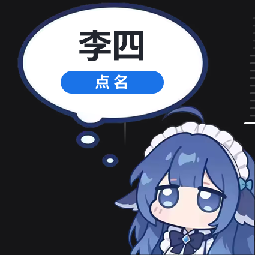

# 随机点名 · RandomPicker

> 一个贴在屏幕右边缘的小家伙。点一下，小鲸鱼从气泡里叫你抽一个人。

纯 **C++ / Win32 API + GDI+** 手写，不依赖任何 GUI 框架，不需要运行库，整个文件夹拷到 U 盘就能走。
待机是一枚蓝色椭圆胶囊，展开后是「小鲸鱼 + 气泡」插画，姓名和「点名」按钮都画在气泡里。
常驻托盘，可开机自启，抽谁完全随机且不会连着重复。

作者：**6evan775（名名）** · [GitHub](https://github.com/6evan775) · [MIT License](LICENSE)

当前版本：**v1.0.1**




---

## 它长什么样

| 待机 | 展开 |
| --- | --- |
| 屏幕右边缘一枚蓝色椭圆胶囊，里面是白色人形图标，带呼吸光圈，可上下拖动 | 小鲸鱼插画：气泡内是大号姓名 + 蓝色「点名」按钮，气泡外是人物本体 |

- 鼠标移上去，图标轻微放大、椭圆变亮；
- 点击后有一小段 **弹出动画**：胶囊从小放大、淡入成插画，同时「啵」一声；
- **点人物本体（气泡以外的角色）即可收起**，配一声下滑音；
- 整窗是逐像素 Alpha 分层窗口，插画边缘平滑，没有白边或灰边。

---

## 功能

### 点名
- 读取同目录 `names.txt`，每行一个姓名。
- 点「点名」后姓名快速滚动，约 **1 秒**内逐渐减速定格，定格时名字弹一下 + 提示音。
- 滚动期间按钮变浅蓝并显示「抽取中…」，此时点击无效，防止连点。
- **不会连着重复**：自动排除最近抽中的 2 个人；名单 ≤ 2 人时自动解除该限制。
- 名字太长会自动缩小字号，再放不下就省略号。

### 待机椭圆
- 贴在屏幕右边缘（自动避开任务栏），**按住可上下拖动**，松手后位置写进 `settings.ini`，下次启动还在那儿。
- 拖动时不会误触发展开；只有「按下-松开没移动」才算点击。
- 呼吸光圈每 2.2 秒一轮，存在感很低但一眼能找到。

### 展开卡片
- 整窗是一张「小鲸鱼 + 气泡」插画，气泡里只放**姓名**和**点名按钮**两样东西，干净不抢戏。
- **点人物本体（气泡以外的区域）收起**，点气泡空白不会误收起。
- 气泡空白处按住可以**拖动窗口**，拖完不会误触发收起。
- 卡片边长 340（96 DPI 基准），比早期版本更小；屏幕不够大时自动收缩，不会出屏。
- 名字过长自动缩字号，再放不下加省略号。

### 托盘
- 常驻系统托盘，图标是蓝底白人形。
- **左键**：展开 / 收起卡片。
- **右键**：展开卡片、重新加载名单、编辑 names.txt、音效开关、开机自启开关、触摸防误触、打开配置文件、关于、退出。
- 任务栏重启（explorer 崩溃）后会自动重新注册托盘图标。

### 触摸屏防误触（希沃 / 白板）
在希沃一体机上用红笔写字时，偶尔会突然变回光标——这是**浮窗抢走触摸**导致的：

1. 待机椭圆始终置顶，手掌扫过屏幕右边缘时命中了它；
2. Windows 收到触摸后，会再合成一次 `WM_LBUTTONDOWN`；
3. 浮窗吃掉这一下，白板这一笔就断了，并被当成一次点击 → 工具退回光标。

本程序的处理（`settings.ini` 里 `touch_guard=1`，默认开）：

- **不注册触摸**（不调用 `RegisterTouchWindow`），窗口收不到原生触摸；
- `WM_TOUCH` / `WM_GESTURE` 直接吞掉，**不返回 `DefWindowProc`**，系统就不会二次合成鼠标消息；
- 结果是触摸完全落到下层白板，写字不再被打断。

代价：开启后**待机椭圆只能用鼠标点**，手指点不动。要展开时用**托盘图标左键**即可。

不想用可以关掉（`touch_guard=0` 或托盘菜单取消勾选），代价是写字时可能再次断笔。

### 音效
- 全部**实时合成**，不依赖任何 wav/mp3 文件，也不依赖系统提示音。
- 五种：展开「啵」、收起下滑、按钮点击、滚动「哒哒」、定格双音上行。
- 音量可在 `settings.ini` 调（0~100），也可以菜单里一键静音。
- 没有声卡 / 音频设备被占用时**静默降级**，不会报错、不影响点名。

### 开机自启
- 由 `settings.ini` 里的 `autostart=1/0` **单独控制**，程序启动时按这个值同步注册表。
- 只写 `HKEY_CURRENT_USER\...\Run`，**不需要管理员权限**，不弹 UAC。
- 重复运行不会重复写入；换目录后会自动更新为新路径。
- 托盘菜单里也能直接开关，改完会同步回 `settings.ini`。

---

## 快速开始

1. 把整个文件夹（`RandomPicker.exe`、`names.txt`、`settings.ini`、`assets\whale.png`）拷到一起。
2. 双击 `RandomPicker.exe`。
3. 屏幕右边缘出现蓝色椭圆 → 点它 → 小鲸鱼弹出 → 点「点名」。
4. 想收起：点小鲸鱼本体（气泡外面）。

> 首次运行如果缺 `names.txt`，程序会自动生成一份 8 人示例并提示你去改。
> 缺 `settings.ini` 也会自动生成带注释的默认配置。

### 文件说明

```
RandomPicker/
├─ RandomPicker.exe    主程序
├─ RandomPicker.cpp    源码
├─ assets/
│   └─ whale.png       界面插画（小鲸鱼 + 气泡）
├─ names.txt           名单，每行一个姓名
├─ settings.ini        配置（音效/音量/自启/待机位置/动画时长）
├─ README.md           本文件
├─ PROVENANCE.md       素材来源声明
└─ LICENSE             开源协议
```

> **`assets\whale.png` 不能少**：它是展开后的整个界面。缺失时程序仍能点名，
> 但卡片会退化成纯色背景，并在启动时弹一次提示。

---

## names.txt

每行一个姓名，就这么简单：

```text
张三
李四
王五
赵六
```

细节：

- **编码**：UTF-8（带不带 BOM 都行）或 ANSI/GBK 都能自动识别，推荐记事本「另存为 → UTF-8」。
- 空行自动忽略；以 `#` 开头的行算注释。
- 行首行尾的空格、Tab、全角空格会自动去掉。
- 改完名单不用重启：托盘右键 →「重新加载名单」。
- 人数不限，1 个人也能正常点名。

带注释的例子：

```text
# 高一(3)班
张三
李四

# 转学生
王五
```

---

## settings.ini

程序启动时读取，改完保存后**重新启动程序**生效（音效开关在菜单里改是立即生效的）。

```ini
[general]
sound=1        ; 音效：1 开，0 关
volume=70      ; 音量 0~100
autostart=1    ; 开机自启：1 开，0 关（本文件就是开关）

[ui]
dock_y=-1      ; 待机椭圆垂直位置，-1 = 自动居中；拖动后自动写入
anim_ms=260    ; 弹出动画时长（毫秒），80~1500
touch_guard=1  ; 触摸防误触：1 开（推荐），0 关
```

| 键 | 取值 | 说明 |
| --- | --- | --- |
| `sound` | 0 / 1 | 音效总开关 |
| `volume` | 0 ~ 100 | 音量，超过范围会自动夹住 |
| `autostart` | 0 / 1 | 开机自启，程序启动时按此值增删注册表项 |
| `dock_y` | -1 或屏幕 Y 坐标 | 待机椭圆位置，`-1` 表示垂直居中 |
| `anim_ms` | 80 ~ 1500 | 弹出动画时长，越大越「慢镜头」 |
| `touch_guard` | 0 / 1 | 触摸防误触。**1 = 不接收触摸**，写字不打断；0 = 正常接收触摸 |

> 想把待机椭圆放回屏幕中间：把 `dock_y` 改回 `-1` 重启即可。

---

## 快捷键 / 操作一览

| 操作 | 效果 |
| --- | --- |
| 左键点待机椭圆 | 展开卡片（`touch_guard=1` 时需用鼠标） |
| 按住待机椭圆上下拖 | 移动待机位置（自动记忆） |
| 左键点「点名」 | 开始滚动抽取 |
| 气泡空白处按住拖 | 移动卡片 |
| **点人物本体（气泡外）** | 收回右边缘 |
| `Esc` | 收起卡片 |
| 右键（卡片或托盘） | 弹出菜单 |
| **托盘左键** | 展开 / 收起（触摸屏上用它代替点待机条） |
| 再运行一次 exe | 唤醒已有窗口并展开（不会开第二个） |

---

## 从源码编译

### MinGW-w64 / Dev-C++ 自带 g++

```bat
g++ RandomPicker.cpp -o RandomPicker.exe -std=c++11 -O2 -mwindows ^
    -static -static-libgcc -static-libstdc++ ^
    -lgdiplus -lgdi32 -luser32 -lshell32 -ladvapi32 -lwinmm
```

- `-mwindows`：GUI 子系统，不弹黑框控制台。
- `-static*`：运行时静态链接，exe 拷到没装编译器的电脑也能跑。
- `-lgdiplus`：v1.0.0 起界面改用 GDI+ 逐像素 Alpha 绘制，**必须**加这个库。
- 想更小：把 `-O2` 换成 `-Os` 并加 `-s`（去符号表）。

> MinGW 下 `gdiplus.h` 需要先 `#include <objidl.h>`，否则会报 `PROPID does not name a type`。
> 源码里已经处理好了，自己改代码时别把这两行的顺序调换。

### Dev-C++ 图形界面

1. `文件 → 新建 → 项目 → Windows Application`，语言 C++。
2. 把 `RandomPicker.cpp` 全部内容粘进 `main.cpp`。
3. `项目 → 项目属性 → 参数 → 链接器` 加：`-lgdiplus -lgdi32 -luser32 -lshell32 -ladvapi32 -lwinmm`。
4. F11 编译运行。

### MSVC

```bat
cl /nologo /utf-8 /std:c++14 /O2 /EHsc /DUNICODE /D_UNICODE RandomPicker.cpp ^
   /link /SUBSYSTEM:WINDOWS user32.lib gdi32.lib advapi32.lib shell32.lib winmm.lib gdiplus.lib
```

> 源码里已写 `#pragma comment(lib, ...)`，MSVC 下 lib 不写也能链接。
> 32 位编译器（`-m32` 或 VS 的 x86 工具链）同样可以编出 32 位 exe。

**环境要求**：Windows 7 及以上。已在 Windows 10 x64 + TDM-GCC 4.9.2 实测通过。

---

## 自定义外观

所有可调参数集中在源码顶部「一、可自定义参数」，改完重新编译即可，**不需要动核心逻辑**。

```cpp
// 待机椭圆
#define DOCK_WIDTH          46     // 椭圆宽
#define DOCK_HEIGHT         64     // 椭圆高
#define DOCK_MARGIN_RIGHT   4      // 距右边缘
#define DOCK_ICON_RATIO     0.62   // 人物图标占比
#define DOCK_BREATH_MS      2200   // 呼吸周期

// 展开卡片（整张就是插画，正方形）
#define CARD_WIDTH          340    // 边长，越大越占地方
#define CARD_RIGHT_MARGIN   24     // 距屏幕右边缘

// 气泡里元素的位置（以气泡半轴为单位，改尺寸时自动等比）
#define BUBBLE_NAME_DY0     (-0.60)
#define BUBBLE_NAME_DY1     0.02
#define BUBBLE_BUTTON_DY0   0.16
#define BUBBLE_BUTTON_DY1   0.58
#define NAME_FONT_RATIO     0.62   // 姓名字号 = 气泡半轴 × 该值

// 配色
#define COLOR_BLUE          RGB(0x1A, 0x73, 0xE8)
#define COLOR_CARD_BG       RGB(0xFF, 0xFF, 0xFF)

// 行为
#define HISTORY_EXCLUDE_COUNT   2      // 排除最近 N 次
#define ROLL_DURATION_MS        1000   // 滚动时长
#define ROLL_INTERVAL_START_MS  30     // 起始帧间隔（越小越快）
#define ROLL_INTERVAL_END_MS    190    // 结束帧间隔（越大越慢）
#define ANIM_EXPAND_MS          260    // 弹出动画时长
```

完整清单见源码注释。

**关于缩放**：尺寸都按 96 DPI 设计，启动时按系统缩放比例（100%/125%/150%）等比放大，
所以在不同一体机上视觉大小一致。若希望物理像素绝对不变，把 `S()` 改成 `return value;`。

**换成别的字体**：把 `FONT_FACE` 改成 `L"SimHei"`（黑体）或 `L"SimSun"`（宋体）。
系统缺「微软雅黑」时中文会显示成方块。

---

## 卸载

1. 托盘右键 →「退出」。
2. 删掉整个文件夹。
3. 如果开过自启，先执行一次 `RandomPicker.exe --remove-autostart`（会把注册表项删掉并把
   `settings.ini` 的 `autostart` 改成 0）。

程序不写 AppData、不装服务、不留后台进程，退出即干净。

---

## 常见问题

**双击没反应？**
程序是 GUI 子系统，没有控制台窗口。正常表现就是「没反应，但右边缘多了个蓝色椭圆」。
如果连椭圆都没有，看看是不是被别的置顶窗口挡住了，或者托盘里点一下。

**中文变方块？**
系统缺微软雅黑。改 `FONT_FACE` 为 `L"SimHei"` 重新编译。

**一体机是 32 位系统？**
用 32 位编译器加 `-m32` 编一个，或者直接用 Dev-C++ 的 32 位配置。

**放在 U 盘里带过去，自启会怎样？**
自启项记录的是 exe 的绝对路径。U 盘拔掉后开机自启会静默失败（不报错、不拖慢开机）。
建议到一体机后把整个文件夹复制到本地（如 `D:\点名\`）再运行一次。

**能开两个吗（一个抽男生一个抽女生）？**
默认单实例。把 `#define SINGLE_INSTANCE 1` 改成 `0` 重新编译，
两个 exe 放在不同文件夹、各自带 `names.txt` 即可。注意自启项只有一个。

**托盘图标找不到？**
Win10 默认会把新图标收进「^」溢出区。拖到任务栏常显即可，或
`设置 → 个性化 → 任务栏 → 选择哪些图标显示在任务栏上`。

**在希沃白板上用红笔，写着写着变成光标？**
这是浮窗抢触摸导致的，v1.0.1 已修。确认 `settings.ini` 里 `touch_guard=1`。
如果还不行，把浮窗退出（托盘右键 → 退出）再试，若退出后正常就说明确实是它，
把 `settings.ini` 和你的希沃白板版本号发给我。

**开了触摸防误触后，手指点不开待机条了？**
这是预期行为：`touch_guard=1` 时窗口不接收触摸。改用**托盘图标左键**展开，
或者把 `touch_guard` 改成 `0` 重新启动。

---

## 技术实现

| 模块 | 做法 |
| --- | --- |
| 无边框浮窗 | `WS_POPUP` + `WS_EX_TOPMOST` + `WS_EX_TOOLWINDOW` + `WS_EX_LAYERED` |
| 逐像素透明 | `UpdateLayeredWindow` + 32bpp 预乘 Alpha DIB，整窗内容由 GDI+ 绘制（GDI 的 `Ellipse`/`FillRect` 不写 Alpha，做不出平滑边缘） |
| 插画缩放 | `Gdiplus::Bitmap` 高质量双三次缩放，按窗口尺寸缓存，尺寸变了才重建 |
| 气泡定位 | 气泡在插画中的归一化坐标写死为宏（实测自原图），气泡内元素按半轴比例换算 |
| 形变动画 | 每 15ms 插值窗口矩形 + 透明度；缓动用 `EaseOutBack` / `EaseInCubic` |
| 内容缩放 | 动画期间把卡片渲染到全尺寸位图，等比缩放居中，避免变形 |
| 待机图标 | GDI+ 画椭圆渐变 + 头肩简笔画，呼吸光圈按 `GetTickCount64` 相位驱动 |
| 托盘图标 | 4×4 超采样软件光栅出 32×32 带 Alpha 位图 → `CreateIconIndirect` |
| 音效 | `waveOut` + 回调，实时合成正弦/三角/噪声 + 指数包络，16 声道复用 |
| 名单编码 | 先按 UTF-8 严格解码，失败回落 `CP_ACP` |
| 触摸防误触 | 不注册触摸 + 吞掉 `WM_TOUCH`，阻止系统二次合成鼠标消息 |

依赖：`kernel32 / user32 / gdi32 / gdiplus / advapi32 / shell32 / winmm`，全部系统自带。

> **为什么不给窗口加 `CS_DROPSHADOW`**：分层窗口上系统会自己补一层不透明阴影，
> 在浅色背景上看起来就是一条灰黑色的硬边。v1.0.0 已去掉，改由插画自身的描边提供轮廓。

> **为什么吞掉 `WM_TOUCH` 就能修好断笔**：Windows 对未处理的 `WM_TOUCH` 会再合成
> 一次 `WM_LBUTTONDOWN`。浮窗置顶，手掌擦过右边缘时命中它，这一下就把白板
> 正在画的那一笔打断了，并被当成一次点击，工具于是退回光标。
> 只要不返回 `DefWindowProc`、也不注册触摸，系统就不会合成鼠标消息，
> 触摸会完整落到下层白板。

---

## 素材来源

界面插画 `assets/whale.png` 来自开源项目 **dsh-whale-widget**（DSH 余额小挂件）：

| 项目 | 信息 |
| --- | --- |
| 原文件 | `assets/DSniang02.png`（1026×1026，带气泡的整图） |
| 作者 | **MeteorNOX** |
| 仓库 | <https://github.com/MeteorNOX/DeepSeek-Balance-Whale-Widget> |
| 协议 | MIT License |

**特别感谢 MeteorNOX 创作并开源了这只小鲸鱼**，本项目的展开界面直接使用这张插画，
姓名与「点名」按钮按气泡位置叠加绘制。原图版权归原作者所有，遵循 MIT 协议使用。

本项目的 MIT 协议**不覆盖**该插画——它仍归原作者。若你需要商用或再分发，
请保留上方署名与仓库链接，具体以原仓库 LICENSE 为准。详见 [PROVENANCE.md](PROVENANCE.md)。

---

## AI 使用声明

本项目在开发过程中使用了 **AI 辅助进行代码编写**。

**所有功能逻辑均由开发者人工审核、调试与修改**：

- 每一处功能实现均经过实际编译、运行与交互验证，而非直接采纳生成结果；
- 绘制、动画、音频合成、注册表读写等关键路径均由人工逐项测试确认；
- AI 生成内容仅作为初稿参考，最终交付代码以人工审核后的版本为准；
- 代码中的注释、参数取值与行为取舍，由开发者根据实际运行效果调整确定。

本项目按「现状」（AS IS）提供，不附带任何明示或暗示的担保，详见 [LICENSE](LICENSE)。

---

## 开源协议

[MIT](LICENSE) —— 随便用、随便改、随便商用，保留版权声明即可。

Copyright (c) 2026 **6evan775（名名）** · [github.com/6evan775](https://github.com/6evan775)

欢迎提 issue 和 PR。
